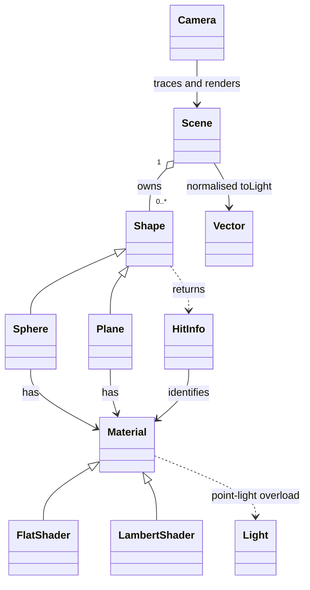

# Domain model and tech-lead review

`Shape::hit` returns the nearest hit with `t > 0` and a unit normal, or no hit.
`Scene` owns its shapes and uses their `t` values to choose the nearest hit.
The renderer uses a directional `toLight` vector, normalized by `Scene`;
materials require that vector and the hit normal to be unit length. The
point-light `Light` type from earlier work is also retained: the material
strategies support it through a separate overload.

## Step 16: review

### Responsibilities and evidence

- [Colour](../include/colour/colour.h#L3) stores the three colour channels.
- [Material](../include/material/material.h#L9) defines shading strategies;
  [HitInfo](../include/geometry/hit_info.h#L8) carries `t`, point, normal and
  material. The directional overload's unit-vector contract is at
  [Material::shade](../include/material/material.h#L13).
- [Ray](../include/ray/ray.h#L5) stores a ray and exposes
  [Ray::at](../src/ray/ray.cpp#L14), reused by
  [Sphere](../src/sphere/sphere.cpp#L24) and
  [Plane](../src/geometry/plane.cpp#L30).
- [Shape](../include/geometry/shape.h#L8) states the shared intersection
  contract. Sphere and Plane implement their own geometry.
- [Scene](../src/scene/scene.cpp#L24) owns shapes and chooses the smallest
  positive `t`.
- [Camera::trace](../src/camera/camera.cpp#L34) asks Scene for a hit and shades
  it; [Camera::render](../src/camera/camera.cpp#L43) builds the image.
- [main](../src/main.cpp#L22) is the composition point that selects the
  directional light, sphere, plane and their materials.
- Tests cover the sphere's inside-ray branch in
  [test_sphere.cpp](../tests/sphere/test_sphere.cpp#L106), the floor
  intersection in [test_plane.cpp](../tests/geometry/test_plane.cpp#L37), and
  nearest-hit order, farther shapes, and misses in
  [test_scene.cpp](../tests/scene/test_scene.cpp#L36),
  [test_scene.cpp](../tests/scene/test_scene.cpp#L60), and
  [test_scene.cpp](../tests/scene/test_scene.cpp#L83).

### SOLID

| Principle | Applies? | Review |
| --- | --- | --- |
| **S — Single Responsibility** | Yes | Geometry owns intersection math, Material shades, Scene selects a hit. Camera handles ray generation and also tracing/rendering; park a split until a concrete change makes it useful. |
| **O — Open/Closed** | Yes | A new shape can implement Shape without changing existing shapes, Scene or Camera. It needs a new header/source/test, CMake entries, and a `main.cpp` change only if the demo uses it. |
| **L — Liskov Substitution** | Yes | Sphere and Plane both honor Shape's `t > 0`, unit-normal, optional-hit contract. |
| **I — Interface Segregation** | Yes | Shape exposes only `hit`. Material's two `shade` overloads represent the two light forms already requested, not unrelated responsibilities. |
| **D — Dependency Inversion** | Yes | Camera uses Scene; Scene stores Shapes; only `main.cpp` selects concrete Sphere and Plane types. |

For a Cylinder, add
`include/geometry/cylinder.h`, `src/geometry/cylinder.cpp`, and
`tests/geometry/test_cylinder.cpp`. Register the source and test in
[CMakeLists.txt](../CMakeLists.txt#L21) and
[CMakeLists.txt](../CMakeLists.txt#L62). Change
[main.cpp](../src/main.cpp#L22) only if the demo should display the cylinder.
No existing Shape, Scene, Camera, or trace implementation needs to change.

### DRY and Clean Code

- `Ray::at` and `Vector::normalised` centralize operations shared by shapes
  and Scene ([Ray::at](../src/ray/ray.cpp#L14),
  [Vector::normalised](../src/math/vector.cpp#L42),
  [Scene](../src/scene/scene.cpp#L10)). Sphere and Plane keep separate
  intersection formulas because their geometry differs.
- Sphere and Plane each store and return their material
  ([Sphere](../include/sphere/sphere.h#L14),
  [Plane](../include/geometry/plane.h#L23)). This is a small, explicit amount
  of plumbing; revisit it when another shape is added rather than introducing
  another abstraction now.
- Private data uses underscore-prefixed names
  ([Sphere](../include/sphere/sphere.h#L12),
  [Plane](../include/geometry/plane.h#L21)) and accessors describe the value.
  Shape's comment documents a contract; test names describe behavior.
- Repeated numeric inputs in geometry tests remain visible as examples of the
  ray tracer's behavior, rather than being hidden in a shared fixture.
- [main.cpp](../src/main.cpp#L1) still includes `<filesystem>` without using
  it; park that small cleanup because it is unrelated to the two behavior
  fixes for this step.

### Decisions

- **Fix:** add the forward-hit test because a ray starting inside must ignore
  the negative root; document the unit-vector contract and normalize
  `toLight` in Scene because Lambert shading uses a dot product whose value
  assumes unit vectors.
- **Park:** splitting Camera until ray generation and rendering have separate
  change drivers; adding a polymorphic light hierarchy until another light
  model needs one; and refactoring shape/material storage until another shape
  demonstrates a useful common abstraction. Also park the unused
  `<filesystem>` include in `main.cpp` as unrelated cleanup.
- **Keep:** HitInfo's point because it is part of the intersection result; the
  earlier point-light `Light` overload to preserve that requested behavior;
  and the exact zero test because only a zero denominator is parallel.
- **Reject:** extracting shared test setup where it would hide the explicit
  geometry values that make each test readable. `sphere.h` does not include
  `colour.h`, and no time-sensitive test comments were present, so those
  proposed cleanups do not apply.
